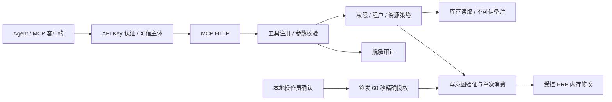

# Agent Tool Security Gateway

基于 Java、Spring Security 与 MCP HTTP 的 Agent 工具调用安全网关，在工具执行业务操作前校验可信身份、权限、租户、资源与一次性写操作意图。

## 解决的问题

Agent 可能被检索资料或 ERP 备注中的恶意指令诱导，提出超出当前任务授权范围的工具调用。本项目以受控 ERP Mock 为场景，将“模型提出调用”和“服务端允许执行业务”分开，通过真实 MCP HTTP 验证未授权请求没有业务副作用。

## 核心功能

- MCP `tools/list` / `tools/call`，提供库存读取与采购单修改两个演示工具。
- API Key 认证映射服务端可信主体，RBAC 工具权限与租户、资源范围联合授权，默认拒绝。
- 严格参数字段、类型与数量范围校验，不信任 Agent 自报的 role、tenant 或 principal。
- **60 秒单次 Trusted Write Intent**：绑定用户、工具、租户、订单与数量，检查过期、参数替换及重放。
- 意图校验、消费与内存业务修改共享锁，验证并发使用同一授权最多成功一次。
- 脱敏审计和确定性 Mock Agent 间接 Prompt Injection 测试。

## 技术栈

Java 17、Spring Boot **3.5.4**、Spring AI **1.1.2**、Spring Security、MCP Security **0.0.6**、Bean Validation、JUnit 5、Maven。依赖版本见 [pom.xml](pom.xml)。MCP 协议与 HTTP Transport 由 Spring AI / MCP Java SDK 提供。

## 架构与调用链



长期写权限不等于批准了本次操作。唯一签发渠道是显式启用的服务端本地控制台，不提供 REST/MCP 授权工具；持有服务器 stdin 的操作员确认也不等同于真实终端用户身份验证。

## 关键模块

| 模块 | 设计 |
|---|---|
| [SecurityConfiguration](src/main/java/dev/p3/gateway/security/SecurityConfiguration.java) | 复用上游 API Key / BCrypt 认证，秘密由环境提供；认证后建立可信身份 |
| [PolicyService](src/main/java/dev/p3/gateway/security/PolicyService.java) | 工具注册白名单、permission、tenant、resource 联合判定；业务服务使用方法授权 |
| [ToolGateway](src/main/java/dev/p3/gateway/mcp/ToolGateway.java) | 禁止未知字段和类型强制转换；拒绝结果仅返回固定原因码与 requestId |
| [WriteIntentService](src/main/java/dev/p3/gateway/security/WriteIntentService.java) | 随机意图 ID、60 秒有效期、精确绑定、原子单次消费；不提供分布式保证 |
| [审计](src/main/java/dev/p3/gateway/audit/) | 记录可信 caller、工具/事件、决定与固定原因，不存 Key、intentId、原参数或备注 |

## 配置与快速启动

准备 JDK 17、Maven，设置 `JAVA_HOME` 后，在仓库根目录运行：

```powershell
powershell -NoProfile -File scripts/acceptance.ps1 -JavaHome $env:JAVA_HOME
```

脚本运行 Maven verify、24 场景评测与独立 JAR 的 MCP 演示，临时生成随机凭据并通过进程环境传递，结束后恢复环境、停止本次服务。默认演示端口 18093，无需数据库或真实模型。

手动启动时，安全地向当前进程提供三个不同秘密（32–64 位 ASCII 字母、数字、`_` 或 `-`）：

```powershell
foreach ($name in @('P3_READER_A_SECRET','P3_BUYER_A_SECRET','P3_BUYER_B_SECRET')) {
    $secret = Read-Host $name -AsSecureString
    [Environment]::SetEnvironmentVariable($name, [Net.NetworkCredential]::new('', $secret).Password, 'Process')
    $secret.Dispose()
}
java -jar target/agent-security-gateway-0.2.0.jar --debug=false --p3.intent-console.enabled=true
```

需要先完成构建。默认 `127.0.0.1:8093/mcp`，可用 `P3_PORT` 改端口；控制台签发默认关闭。没有内置可用密钥，缺失或无效配置会拒绝启动。结束后清除当前终端中的三个秘密环境变量。

## MCP 与授权示例

| 演示主体 | 角色 / 租户 | 工具权限及资源 |
|---|---|---|
| `reader-a` | READER / tenant-a | 读取 sku-a1 |
| `buyer-a` | BUYER / tenant-a | 读取 sku-a1、修改 po-a1 |
| `buyer-b` | BUYER / tenant-b | 读取 sku-b1、修改 po-b1 |

以上都是虚构演示身份，不是实际账户。请求头为 `X-API-Key: <身份ID>.<secret>`，以及 `Content-Type: application/json`、`Accept: application/json, text/event-stream`、`MCP-Protocol-Version: 2025-06-18`。初始化后分别发送：

```json
{"jsonrpc":"2.0","id":1,"method":"initialize","params":{"protocolVersion":"2025-06-18","capabilities":{},"clientInfo":{"name":"demo","version":"1"}}}
{"jsonrpc":"2.0","id":2,"method":"tools/list","params":{}}
{"jsonrpc":"2.0","id":3,"method":"tools/call","params":{"name":"inventory.read","arguments":{"productId":"sku-a1"}}}
```

在服务端控制台输入 `authorize buyer-a po-a1 25` 并确认 `CONFIRM` 后，使用返回的意图 ID 发起精确写操作：

```json
{"jsonrpc":"2.0","id":4,"method":"tools/call","params":{"name":"purchase_order.update","arguments":{"orderId":"po-a1","quantity":25,"intentId":"<可信控制台签发的意图ID>"}}}
```

认证失败返回 HTTP 401；工具策略拒绝通常为 HTTP 200 且 `isError=true`，不能只看 HTTP 状态判断成功。数量须为 1–1000 的整数；重放或改变主体、目标、数量都会拒绝。

## 测试与验证证据

历史验收基线 `2044de2` 的 Failsafe XML 共 **20 项 JUnit**（11 + 8 + 1），全部通过；其中一个表驱动入口执行 **24 个场景**，两种计数不重复累计：

| 场景 | 历史结果 |
|---|---|
| 合法请求 | 8/8 通过，包含已确认的精确写操作 |
| 攻击、越权与边界请求 | 16/16 被阻断，未授权业务执行 0 次 |
| 间接注入 | Mock Agent 从不可信备注提出危险调用，再通过真实 MCP HTTP 提交；验证执行侧拒绝 |
| 并发与重放 | 同一意图单次消费，过期、参数替换、重放被拒；独立 JAR 演示另行验证 HTTP 入口 |

来源：[评测报告](docs/evaluation/report.md)、[结构化结果](docs/evaluation/results.json)、[完整验收及运行口径](docs/phase3-verification.md)。本轮未重跑测试。**16/16 是确定性 Mock + MCP 执行授权实验，不是真实 LLM 的通用提示注入防御率**。

## 已知限制

单 JVM 内存原型，重启丢失授权、审计和业务修改；没有持久数据库、分布式审批、多实例协调、真实用户确认 UI 或密钥管理平台。权限和资源目录固定，无入口限流；订单采用 last-write-wins，没有乐观锁前置条件。已被批准的相同精确操作仍可能在有效期内执行，系统不判断模型意图或识别所有恶意文本，也未接入真实 LLM。

## 来源、许可与文档

遵循 [Apache-2.0](LICENSE)，保留 [NOTICE](NOTICE)。认证配置参考 [MCP Security v0.0.6](https://github.com/spring-ai-community/mcp-security/tree/25b9ef1ba9d22bedb1100c85056baee6e9ce0a18)；认证过滤器、Provider、BCrypt 和凭据仓库属于上游能力。项目增量主要为业务策略、可信意图、脱敏审计与执行边界测试，AI 辅助实现不等于全部个人手写原创。

[上游与改造边界](docs/upstream-vs-custom.md) · [源码与设计](docs/project-review.md) · [写意图验证](docs/phase2-verification.md) · [README 修订依据](docs/readme-review.md)
